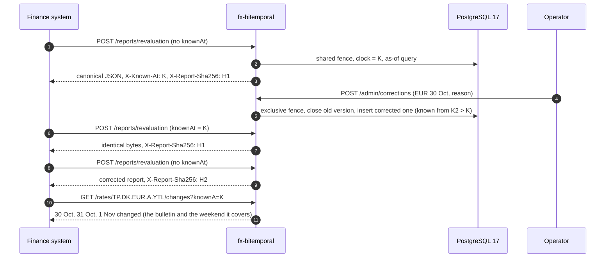
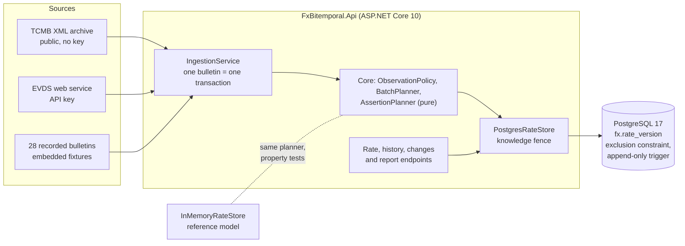

# fx-bitemporal

[](https://github.com/hekimcan206/fx-bitemporal/actions/workflows/ci.yml)
[](https://github.com/hekimcan206/fx-bitemporal/actions/workflows/codeql.yml)
[](LICENSE)
[](global.json)

A TCMB exchange-rate service with a **bitemporal** model. It answers two questions that ordinary rate tables mix up:

- *Valid time*: **"Which rate applied on 31 October?"**
- *Known time*: **"Which rate did the system believe applied on 31 October, when it produced the month-end report on
  3 November?"**

That is why a report pinned to a known time returns **the same bytes forever**, even after the rate behind it has been
corrected.

TCMB (Türkiye Cumhuriyet Merkez Bankası, the Central Bank of the Republic of Türkiye) publishes indicative exchange
rates once per business day. They are the reference for balance-sheet revaluation in Türkiye.

## The problem

Rates change after the fact. A bulletin is missed and back-filled, or an operator finds that a loaded value was wrong.
If the rate table is overwritten, every report re-run from then on gives different numbers from the one that was filed,
and nobody can say why. If rows are only appended with a `loaded_at`, every consumer has to reconstruct which row was
"the" rate for a Sunday, and nothing stops two rows from claiming the same day.

There is also a subtler failure: **even a correctly built bitemporal table can change its past answers** under
concurrency. A writer stamps its rows with a known time before it commits. A reader that runs inside that window gets
one answer, and the same question asked again later gets another. This repository reproduces that anomaly in a test
and prevents it ([ADR 0003](docs/adr/0003-knowledge-fence-for-reproducible-reads.md)).

## The solution in one picture



### Architecture



| Project | Responsibility |
|---|---|
| `FxBitemporal.Core` | Periods, versions, the sequenced-update planner, observation policy, in-memory reference model, canonical report builder, timeline diff |
| `FxBitemporal.Sources` | TCMB XML bulletin parser and archive client, EVDS client, recorded bulletins |
| `FxBitemporal.Api` | PostgreSQL store with the knowledge fence, migrations, HTTP endpoints, ingestion, observability |

## Why this design

- **The invariant lives in the database.** One `fx.rate_version` table holds a `daterange` for valid time and a
  `tstzrange` for known time. `EXCLUDE USING gist (series WITH =, valid_during WITH &&, known_during WITH &&)` makes
  every `(series, date, knownAt)` question have at most one answer. PostgreSQL 18's `WITHOUT OVERLAPS` covers one
  period only, so it cannot express this ([ADR 0001](docs/adr/0001-bitemporal-versions-on-postgresql-ranges.md)).
- **History cannot be edited, even by the owner.** A trigger permits exactly one change: closing `known_during`. The
  app role only has `SELECT`, `INSERT` and `UPDATE (known_during)`. Tests run the attacks and expect them to fail.
- **One planner, proven twice.** The sequenced update is a pure function. FsCheck properties drive it through the
  in-memory model (no overlaps, every past answer reproducible, idempotent replay, one batch equals sequential writes).
  An integration test runs the same random histories against PostgreSQL and requires identical answers.
- **Bulletins, not free-form periods.** A bulletin for D is valid until the next believed bulletin, which covers
  weekends, holidays and late back-fills. Re-ingesting what is already believed writes nothing, and **a feed re-ingest
  never undoes a correction** ([ADR 0002](docs/adr/0002-bulletin-validity-and-correction-precedence.md)).
- **Known time is final.** Writers lock a series and then read the clock. Readers take the lock shared and then read
  the clock. So no commit can appear "in the past" of an answer already given
  ([ADR 0003](docs/adr/0003-knowledge-fence-for-reproducible-reads.md); Jensen and Lomet, VLDB 2001).
- **Reproducibility you can check without trusting the server.** The report body is canonical JSON, and
  `X-Report-Sha256` is its hash ([ADR 0005](docs/adr/0005-canonical-reports-with-content-hash.md)).
- **Real data, honestly labelled.** The tests and the demo replay 28 real TCMB bulletins recorded from the public
  archive. The EVDS client is tested against fixtures *shaped like* EVDS responses, because this project has no EVDS
  key ([ADR 0004](docs/adr/0004-rate-sources-and-fixtures.md)).

## Quick start

```bash
docker compose up
```

That starts PostgreSQL 17 (least-privilege roles), runs migrations as the owner role, ingests the 28 recorded bulletins
as the app role, starts the API on `http://127.0.0.1:58744` (OpenAPI UI at `/scalar/v1`) and runs the demo. The demo
values three positions, records a synthetic correction, and checks that the earlier report is byte-identical. Output
of the `demo` container (abridged):

```text
report as known at 2026-11-12T11:41:55.616986Z: sha256 a26b83e5f0802d9bc9f35962c6ef60eb189ab038f6afdd2d99b9024275df9500
correction: {"series":"TP.DK.EUR.A.YTL","bulletinDate":"2026-10-30","knownFrom":"2026-11-12T11:41:56.830658Z","closed":1,"inserted":1,"changed":true}
report replayed as of 2026-11-12T11:41:55.616986Z: sha256 a26b83e5f0802d9bc9f35962c6ef60eb189ab038f6afdd2d99b9024275df9500
report as known now: sha256 4374413834fda979d2648ff67bc4033648738bffd20282937ac4a4cb3e212aed
{"demo":"fx-bitemporal","correctionChanged":true,"reproducible":true,"failures":[]}
```

Try it yourself:

```bash
# Which USD forex buying rate applied on Sunday 1 November? (Friday's bulletin, carried over the weekend)
curl -i "http://127.0.0.1:58744/api/v1/rates/TP.DK.USD.A.YTL?date=2026-11-01"
# ...and as the system knew it at an earlier instant: pass back any X-Known-At value
curl "http://127.0.0.1:58744/api/v1/rates/TP.DK.EUR.A.YTL?date=2026-10-31&knownAt=2026-11-12T11:41:55.616986Z"
# Every belief about a date, oldest first
curl "http://127.0.0.1:58744/api/v1/rates/TP.DK.EUR.A.YTL/history?date=2026-10-31"
# Ingest from the live public archive (no key needed)
curl -X POST -H "X-Admin-Key: admin-dev-only" -H "Content-Type: application/json" \
     -d '{"from":"2026-11-02","to":"2026-11-12","source":"tcmb-archive"}' http://127.0.0.1:58744/api/v1/admin/ingest
```

| Endpoint | Purpose |
|---|---|
| `GET /api/v1/rates/{series}?date=&knownAt=` | Rate in effect on a date, as known at `knownAt` (default: now). Returns `X-Known-At` |
| `GET /api/v1/rates/{series}/history?date=` | Every version that ever covered the date (audit trail) |
| `GET /api/v1/rates/{series}/changes?from=&to=&knownA=&knownB=` | Dates whose answer differs between two known times |
| `POST /api/v1/reports/revaluation` | Value FX positions in TRY; canonical JSON body plus `X-Report-Sha256` |
| `POST /api/v1/admin/ingest` | Ingest a date range from `fixture`, `tcmb-archive` or `evds` (idempotent) |
| `POST /api/v1/admin/corrections` | Correct one bulletin's value; needs a reason |

Series use EVDS codes: `TP.DK.{CCY}.{A|S}[.EF].YTL` (A = buying, S = selling, EF = banknote), for example
`TP.DK.USD.A.YTL`.

### Development

```bash
docker compose up -d postgres migrator ingest     # database on 127.0.0.1:58743
dotnet run --project src/FxBitemporal.Api         # uses appsettings.Development.json
dotnet test                                       # 82 unit/property/golden + 29 integration tests (Docker needed)
```

## Results (measured)

All numbers were measured on this machine. They are medians unless stated otherwise. Method, raw data and the
environment are in [docs/benchmarks.md](docs/benchmarks.md). Environment: Intel Core i7-13620H (16 logical cores),
15.7 GB RAM, Windows 11, .NET 10.0.12, Docker Desktop (engine 29.9.1, WSL2, 7.6 GB VM), PostgreSQL 17 (`postgres:17-alpine`).
The host was shared with other projects' containers and another agent's build (about 60% CPU load at the start), so
treat the tails as pessimistic.

PostgreSQL store, synthetic two-year history (20 series × 520 bulletins + 117 corrections = 20,897 versions), two
runs:

| Measurement | Run 1 | Run 2 |
|---|---|---|
| As-of read, "now", fenced (n=2000) | 1.91 ms (p95 3.27) | 2.66 ms (p95 6.24) |
| As-of read, "now", naive, no fence (n=2000) | 1.41 ms (p95 2.10) | 1.60 ms (p95 2.39) |
| As-of read, pinned past known time (n=2000) | 2.10 ms (p95 3.65) | 1.66 ms (p95 2.36) |
| 12-series report read, one fence (n=500) | 2.34 ms | 2.22 ms |
| Bulletin write, 20 series, one transaction (n=520) | 65.1 ms (p95 89.9) | 65.6 ms (p95 119.3) |
| Bulletin write, first 50 vs last 50 | 71.9 vs 65.2 ms | 59.9 vs 66.1 ms |
| Correction write (n=117) | 8.0 ms | 5.5 ms |
| Contended reads: 4 readers + 1 writer correcting the same series, fenced | 7.8 ms, 471 reads/s | 8.9 ms, 418 reads/s |
| Same, naive | 2.2 ms, 1,737 reads/s | 2.5 ms, 1,439 reads/s |
| As-of query plan (EXPLAIN ANALYZE) | Bitmap Heap Scan, 0.52 ms, 5 buffers | Bitmap Index Scan on `no_bitemporal_overlap`, 0.81 ms, 6 buffers |

Through the full HTTP stack (`docker compose`, sequential, host to container, n=1000): `GET` rate **4.9 ms**
(p95 26.3), `POST` 3-position report **4.1 ms** (p95 17.1).

Correctness under concurrency (integration tests): with naive stamping, a reader racing a held-back commit got an
answer that **changed** afterwards. With the fence, 3 writers and 6 readers ran for 4 s and every recorded
`(knownAt, answer)` pair was re-asked: **0 mismatches**.

In-process micro-benchmarks (BenchmarkDotNet, median): parsing a bulletin **86 µs**, planning a 67-series bulletin write **95 µs**, building and hashing a 12-position report **14 µs**.

What the numbers say: the fence costs roughly 0.5–1 ms per uncontended read and makes reads queue behind a writer of
the *same* series. That is the price of answers that never change, and bulletins arrive once per business day. Write
latency does not grow with history (first 50 vs last 50 bulletins). Per-bulletin writes are dominated by maintaining
the exclusion constraint's GiST index for the closed and inserted versions. EXPLAIN ANALYZE on a scratch copy: closing
20 versions took 13 ms, inserting 20 took 5 ms.

## Limitations and next steps

- **EVDS is untested against the live service.** There is no API key, so the client is verified against fixtures
  shaped like documented EVDS responses. TCMB moved to EVDS 3 in 2026, and the response shape or key mechanism may
  need an update.
- **Business-date granularity.** Valid time is whole days. Intraday or real-time rates are out of scope.
- **One shared admin key.** There is no per-operator identity, so `recorded_by` names the role. Next step: OIDC with
  the operator recorded on each correction.
- **The hash proves equality, not origin.** Next step: sign reports (JWS) with a managed key.
- **A correction outranks the feed for its bulletin date.** If TCMB itself re-published a bulletin, an operator must
  record the new value as a correction. Conservative by design ([ADR 0002](docs/adr/0002-bulletin-validity-and-correction-precedence.md)).
- **Write amplification.** Each new bulletin closes the open-ended version of the previous one and re-inserts it with
  a bounded period: 1,876 observations became 3,685 versions. Partitioning by known time or archiving closed history
  would be the next step past roughly 10⁷ versions. That is not measured here.
- **Writer clock guard scans current versions.** The "strictly after every current version" guard reads all
  currently believed versions of the bulletin's series. That cost grows with series × bulletins (10,400 rows: 2 ms).
  A per-series high-water-mark table would make it O(series).
- **No scheduler.** Ingestion runs on demand (`POST /admin/ingest`, `--ingest-fixtures`). A daily job after the 15:30
  publication belongs to the deployment.
- **Not measured:** multi-node behaviour, very large histories, and PostgreSQL configuration tuning. All runs used
  the default `postgres:17-alpine` settings.

## Data and privacy

The data is public exchange rates. There is no personal data, so KVKK (the Turkish personal-data protection law) does
not apply. The 28 recorded bulletins are real TCMB publications. Every correction in the tests, the demo and the
benchmarks is synthetic and says so in its reason. Benchmark series (`TP.DK.SAA.A.YTL`, ...) and test series are
synthetic codes. The indicative rates are published by TCMB. This project is not affiliated with TCMB.

## License

[MIT](LICENSE)
